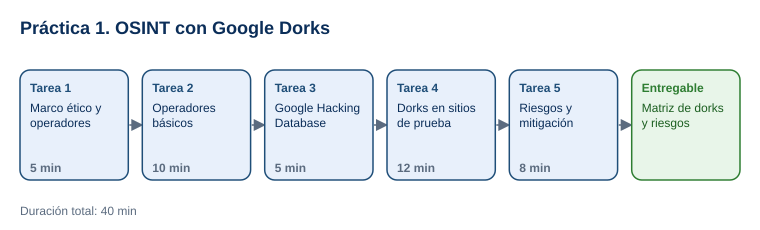

# Práctica 1. OSINT | Introducción a Google Dorks para búsqueda avanzada de información

**Capítulo 1. Ethical Hacking · Práctica 1 de 3**

⏱️ **Duración:** 40 min · 🛠️ **Herramienta:** Google Search · 📄 **Entregable:** `Matriz_Google_Dorks_[INICIALES].xlsx`

## Descripción

La fase de reconocimiento de una prueba de penetración empieza con información pública. Con operadores avanzados del buscador (Google Dorking), un atacante puede encontrar páginas de inicio de sesión, documentos o directorios que una organización publicó sin darse cuenta. En esta práctica el participante aplicará los operadores `site:`, `filetype:`, `intitle:` e `inurl:` sobre sitios públicos y sitios de prueba autorizados, revisará la Google Hacking Database y propondrá cómo reducir la exposición.

## Objetivos de aprendizaje

Al finalizar la práctica, el participante será capaz de:

- Construir búsquedas con los operadores `site:`, `filetype:`, `intitle:`, `inurl:`, comillas y exclusión (`-`).
- Identificar tipos de exposición en los resultados: páginas de inicio de sesión, documentos públicos, directorios e información de configuración.
- Evaluar el riesgo de la información expuesta y proponer medidas de mitigación.
- Aplicar los límites éticos y legales del reconocimiento pasivo.

## Antes de empezar

| Elemento | Valor |
|---|---|
| Dónde trabajar | Navegador web: [google.com](https://www.google.com/) y [Google Hacking Database](https://www.exploit-db.com/google-hacking-database) |
| Archivos de la práctica | [Matriz_Google_Dorks.xlsx](recursos/Matriz_Google_Dorks.xlsx) |
| Carpeta de trabajo | `Documentos\Taller_Ethical_Hacking\Practica01\` |
| Sitio de prueba autorizado | `testfire.net` (aplicación bancaria de demostración de IBM, creada para practicar pruebas de seguridad) |
| Nombre del entregable | `Matriz_Google_Dorks_[INICIALES].xlsx` |

> **Reglas éticas obligatorias:** esta práctica es solo de **búsqueda** (reconocimiento pasivo). No iniciar sesión, no probar contraseñas, no descargar ni abrir archivos que parezcan confidenciales y no interactuar con formularios de los resultados. Si un resultado muestra información sensible de una organización real, no abrirlo: anotarlo como "exposición detectada" y avisar al instructor. Usar estas técnicas sobre sistemas sin autorización puede ser ilegal.

---

## Tarea 1. Marco ético y operadores (5 min)

**Objetivo:** Conocer los operadores y las reglas de la práctica.

**Por qué:** Un ethical hacker solo trabaja dentro del alcance autorizado; el reconocimiento pasivo también tiene límites.

**Paso 1.** Descargar `Matriz_Google_Dorks.xlsx` en `Documentos\Taller_Ethical_Hacking\Practica01\` y guardarlo como `Matriz_Google_Dorks_[INICIALES].xlsx`.

**Paso 2.** Revisar con el instructor la tabla de operadores:

| Operador | Qué hace | Ejemplo |
|---|---|---|
| `site:` | Limita los resultados a un dominio | `site:nist.gov` |
| `filetype:` | Busca un tipo de archivo | `filetype:pdf` |
| `intitle:` | Busca palabras en el título de la página | `intitle:"login"` |
| `inurl:` | Busca palabras en la dirección (URL) | `inurl:admin` |
| `"texto"` | Busca la frase exacta | `"cybersecurity framework"` |
| `-` | Excluye resultados | `-inurl:index` |

**Al terminar esta tarea debes tener:**

- ✔ La matriz descargada y las reglas éticas leídas.

---

## Tarea 2. Operadores básicos en sitios públicos (10 min)

**Objetivo:** Ejecutar los dorks D4 a D6 y registrar los resultados.

**Por qué:** Practicar con información publicada intencionalmente permite ver el efecto de cada operador sin riesgo.

**Paso 1.** En [google.com](https://www.google.com/), escribir el dork **D4** `site:nmap.org filetype:pdf` y presionar **Enter**.

- **Qué verás:** solo documentos PDF del sitio nmap.org. El número aproximado de resultados no siempre aparece; si no aparece, seleccionar **Herramientas** debajo del cuadro de búsqueda.

**Paso 2.** Anotar en la matriz el número aproximado de resultados y el título de un resultado de ejemplo (sin abrir el archivo).

**Paso 3.** Repetir con **D5** `site:cisa.gov filetype:pdf "multifactor"` y **D6** `site:nist.gov intitle:"cybersecurity framework"`.

**Paso 4.** Probar una variación propia de D5 (por ejemplo, cambiar `pdf` por `xlsx`) y comparar cuántos resultados obtiene.

**Al terminar esta tarea debes tener:**

- ✔ D4, D5 y D6 registrados con resultados, ejemplo, tipo de exposición ("Documento público") y riesgo.

---

## Tarea 3. Google Hacking Database (5 min)

**Objetivo:** Completar la hoja `GHDB` con 3 categorías revisadas.

**Por qué:** La GHDB recopila dorks reales usados para encontrar exposición; conocerla ayuda a buscar los mismos problemas en la organización propia.

**Paso 1.** Abrir la [Google Hacking Database](https://www.exploit-db.com/google-hacking-database).

**Paso 2.** En el filtro **Category**, revisar 3 categorías, por ejemplo **Pages Containing Login Portals**, **Files Containing Juicy Info** y **Sensitive Directories**.

**Paso 3.** Copiar un dork de ejemplo de cada categoría en la hoja `GHDB` y explicar qué busca y por qué es un riesgo. **No ejecutarlo en Google** en esta tarea.

**Al terminar esta tarea debes tener:**

- ✔ 3 categorías con dork de ejemplo, propósito y riesgo.

---

## Tarea 4. Dorks en el sitio de prueba autorizado (12 min)

**Objetivo:** Ejecutar D1, D2, D3, D7 y D8 sobre `testfire.net` y clasificar la exposición.

**Por qué:** Así se ve lo que un atacante obtendría de un sitio real, sin afectar a ninguna organización.

**Paso 1.** Ejecutar **D1** `site:testfire.net` y anotar cuántas páginas indexadas aparecen.

**Paso 2.** Ejecutar **D2** `site:testfire.net inurl:login` y **D3** `site:testfire.net intitle:"Altoro"`. Anotar resultados y clasificar la exposición (por ejemplo, "Página de inicio de sesión expuesta").

- **Importante:** no abrir ni probar el formulario de inicio de sesión.

**Paso 3.** Ejecutar **D7** `site:testfire.net -inurl:index` y anotar cómo cambia el número de resultados respecto a D1.

**Paso 4.** Para **D8**, adaptar uno de los dorks de la hoja `GHDB` agregando `site:testfire.net` y ejecutarlo. Anotar el dork exacto y el resultado.

- **Si Google muestra un CAPTCHA:** resolverlo manualmente y esperar un minuto entre búsquedas. No usar herramientas para evadirlo.

**Al terminar esta tarea debes tener:**

- ✔ D1, D2, D3, D7 y D8 registrados con tipo de exposición y riesgo.

---

## Tarea 5. Riesgos y mitigación (8 min)

**Objetivo:** Completar la hoja `Mitigacion` con 3 riesgos y sus medidas.

**Por qué:** El objetivo del ethical hacking es reducir la exposición, no solo encontrarla.

**Paso 1.** Elegir los 3 hallazgos de mayor riesgo de la hoja `Dorks`.

**Paso 2.** Escribir una medida para cada uno. Ejemplos válidos: retirar el archivo del servidor, proteger el directorio con autenticación, desactivar el listado de directorios, solicitar la eliminación del contenido indexado en Google Search Console, revisar periódicamente con dorks el dominio propio. Recordar que `robots.txt` no es un control de seguridad: solo pide a los buscadores que no indexen y es público.

**Paso 3.** Comentar en grupo: ¿qué dork usaría para revisar el sitio de su propia organización (con autorización)?

**Paso 4.** Guardar el archivo.

**Al terminar esta tarea debes tener:**

- ✔ 3 riesgos con medida y responsable sugerido, y la matriz guardada.

---

## Validación y pruebas

| Caso | Acción | Resultado esperado |
|---|---|---|
| Efecto de `filetype:` | Comparar D4 con `site:nmap.org` sin `filetype:` | D4 solo devuelve PDF |
| Exclusión | Comparar D1 y D7 | D7 tiene menos resultados |
| Caso adversarial | Pregunta del instructor: *"Encontraste un archivo con contraseñas de una empresa real, ¿lo abres para confirmar?"* | No: se registra sin abrirlo y se reporta; abrirlo excede el reconocimiento autorizado |

## Entregables

| Entregable | Contenido | Criterio de verificación |
|---|---|---|
| `Matriz_Google_Dorks_[INICIALES].xlsx` | Hojas `Dorks`, `GHDB` y `Mitigacion` | 8 dorks ejecutados con resultados, tipo de exposición y riesgo; 3 categorías de la GHDB; 3 medidas de mitigación |

## Resultado esperado

- El participante construye dorks combinando operadores y clasifica la información expuesta según su riesgo.
- Reconoce que la información indexada es visible para cualquiera y propone cómo reducirla.

## Solución de problemas

**Google no muestra el número de resultados**
- *Síntoma:* no aparece "Cerca de X resultados".
- *Causa:* la interfaz oculta el conteo.
- *Solución:* seleccionar **Herramientas** debajo del cuadro de búsqueda o contar los resultados de la primera página y anotarlo así.

**Un dork no devuelve resultados**
- *Síntoma:* "No se encontraron resultados".
- *Causa:* operador mal escrito (por ejemplo, con espacio después de los dos puntos) o el sitio no tiene ese contenido indexado.
- *Solución:* escribir `operador:valor` sin espacios; si persiste, registrar "0 resultados": también es un hallazgo.

## Limpieza

- Conservar la matriz en `Documentos\Taller_Ethical_Hacking\Practica01\`.
- Cerrar las pestañas de resultados; no guardar ni compartir enlaces de información sensible.

## Recursos opcionales

- [Google: refinar búsquedas web](https://support.google.com/websearch/answer/2466433)
- [Google: quitar información de los resultados de búsqueda](https://developers.google.com/search/docs/crawling-indexing/remove-information)

Complejidad: Fácil · Nivel de Bloom: Aplicar

---

[Inicio](../README.md) | [Siguiente: Práctica 2 ➡](../Capitulo02/README.md)
