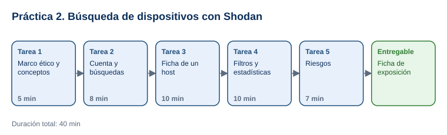

# Práctica 2. Introducción a búsqueda de dispositivos en Internet con Shodan

**Capítulo 1. Ethical Hacking · Práctica 2 de 3**

⏱️ **Duración:** 40 min · 🛠️ **Herramienta:** [Shodan](https://www.shodan.io/) · 📄 **Entregable:** `Ficha_Exposicion_Shodan_[INICIALES].xlsx`

## Descripción

Mientras Google indexa páginas web, Shodan indexa servicios: consulta direcciones IP de Internet y guarda lo que cada servicio responde (el *banner*). Así se pueden encontrar servidores, cámaras, routers y bases de datos expuestos. En esta práctica el participante usará filtros de Shodan para medir la exposición de servicios en un país, analizará la ficha de un host autorizado para pruebas y relacionará cada servicio expuesto con su riesgo.

## Objetivos de aprendizaje

Al finalizar la práctica, el participante será capaz de:

- Explicar qué es un banner y qué información recopila Shodan de cada servicio.
- Usar filtros de Shodan (`port:`, `country:`, `product:`, `hostname:`) y combinarlos.
- Interpretar la ficha de un host: IP, organización, puertos abiertos, servicios y versiones.
- Relacionar servicios expuestos con riesgos de seguridad y recomendaciones.

## Antes de empezar

| Elemento | Valor |
|---|---|
| Dónde trabajar | Navegador web: [shodan.io](https://www.shodan.io/) |
| Archivos de la práctica | [Ficha_Exposicion_Shodan.xlsx](recursos/Ficha_Exposicion_Shodan.xlsx) |
| Carpeta de trabajo | `Documentos\Taller_Ethical_Hacking\Practica02\` |
| Host autorizado para análisis | `scanme.nmap.org`: servidor del proyecto Nmap publicado para pruebas |
| Nombre del entregable | `Ficha_Exposicion_Shodan_[INICIALES].xlsx` |

> **Reglas éticas obligatorias:** Shodan solo se usa para **observar** información ya recopilada. No conectarse a las IP de los resultados, no abrir sus servicios en el navegador, no intentar iniciar sesión y no compartir IP de terceros fuera del taller. Que un servicio esté expuesto no autoriza a nadie a acceder a él.

> **Cuenta gratuita:** crear una cuenta gratuita en Shodan permite usar filtros y ver más resultados. Algunas consultas o filtros avanzados pueden requerir membresía; si Shodan lo indica, usar la consulta alternativa de la tarea.

---

## Tarea 1. Marco ético y conceptos (5 min)

**Objetivo:** Entender qué es un banner y qué muestra Shodan.

**Por qué:** Interpretar correctamente los resultados depende de saber qué guarda Shodan de cada servicio.

**Paso 1.** Descargar la plantilla y guardarla como `Ficha_Exposicion_Shodan_[INICIALES].xlsx`.

**Paso 2.** Revisar con el instructor un banner de ejemplo: `HTTP/1.1 200 OK` y `Server: nginx/1.1.19` indican servicio web y versión del software. Esa versión permite buscar vulnerabilidades conocidas, como en las prácticas de CVE.

**Al terminar esta tarea debes tener:**

- ✔ Claro que Shodan guarda IP, puerto, organización, ubicación y banner de cada servicio.

---

## Tarea 2. Cuenta y primeras búsquedas (8 min)

**Objetivo:** Ejecutar Q1 y Q2 y registrar resultados.

**Por qué:** Los filtros permiten pasar de "todo Internet" a un conjunto concreto de servicios.

**Paso 1.** Abrir [shodan.io](https://www.shodan.io/), seleccionar **Login** > **Create an Account** y registrarse con un correo personal. Si el instructor lo indica, usar una cuenta ya creada.

**Paso 2.** Escribir **Q1** `scanme.nmap.org` en el buscador y presionar **Enter**.

- **Qué verás:** uno o pocos resultados del host de pruebas del proyecto Nmap.

**Paso 3.** Ejecutar **Q2** `port:22 country:MX` (cambiar `MX` por el código de su país si el instructor lo indica).

- **Qué verás:** el total de resultados y, a la izquierda, resúmenes (**Top Organizations**, **Top Products**).

**Paso 4.** Anotar en la hoja `Busquedas` el total y las 3 organizaciones o proveedores principales de Q2.

**Al terminar esta tarea debes tener:**

- ✔ Q1 y Q2 registradas.

---

## Tarea 3. Ficha de un host autorizado (10 min)

**Objetivo:** Completar la hoja `Ficha_host` con los 9 campos de `scanme.nmap.org`.

**Por qué:** La ficha de un host resume lo que un atacante sabría de un servidor sin enviarle un solo paquete.

**Paso 1.** En los resultados de Q1, seleccionar la dirección IP para abrir la ficha del host (o abrir [la ficha de 45.33.32.156](https://www.shodan.io/host/45.33.32.156)).

**Paso 2.** Anotar IP, nombres de host, organización o ISP, país y ciudad, y puertos abiertos.

**Paso 3.** Ubicar el puerto **22** y el puerto **80**, y anotar el servicio y la versión que muestra el banner (por ejemplo, `OpenSSH` y `Apache httpd`).

**Paso 4.** Anotar la fecha **Last Seen** y las vulnerabilidades listadas, si aparecen.

- **Importante:** la lista de vulnerabilidades de Shodan se basa en la versión del banner; es un indicio, no una confirmación.

**Al terminar esta tarea debes tener:**

- ✔ La ficha del host con los 9 campos.

---

## Tarea 4. Filtros y estadísticas (10 min)

**Objetivo:** Ejecutar Q3 a Q6 y comparar la exposición por servicio.

**Por qué:** Comparar cuántos servicios sensibles están expuestos en un país muestra la magnitud del problema.

**Paso 1.** Ejecutar **Q3** `port:3389 country:MX` (escritorio remoto), **Q4** `product:"MySQL" country:MX` (bases de datos) y **Q5** `port:23 country:MX` (Telnet).

**Paso 2.** Para cada consulta, anotar el total y las 3 organizaciones principales.

- **Si Shodan pide membresía para una consulta:** registrar "Requiere membresía" y ejecutar la misma consulta sin `country:`.

**Paso 3.** En **Q6**, combinar dos filtros por su cuenta (por ejemplo, `port:80 product:"Apache httpd" country:MX`) y anotar la consulta y el resultado.

**Al terminar esta tarea debes tener:**

- ✔ Q3 a Q6 registradas con totales y organizaciones.

---

## Tarea 5. Riesgos y recomendaciones (7 min)

**Objetivo:** Completar la hoja `Riesgos` para SSH, RDP, MySQL y Telnet.

**Por qué:** Identificar un servicio expuesto solo es útil si se traduce en una recomendación concreta.

**Paso 1.** Para cada servicio, escribir el riesgo (por ejemplo, Telnet envía credenciales sin cifrar; RDP y MySQL expuestos atraen ataques de fuerza bruta y explotación de vulnerabilidades conocidas).

**Paso 2.** Escribir una recomendación (por ejemplo: cerrar el puerto en el firewall, acceso solo por VPN, autenticación multifactor, actualizar versiones, reemplazar Telnet por SSH).

**Paso 3.** Comentar en grupo: ¿cómo podría una organización usar Shodan para revisar su propia exposición? Guardar el archivo.

**Al terminar esta tarea debes tener:**

- ✔ 4 servicios con riesgo y recomendación, y la ficha guardada.

---

## Validación y pruebas

| Caso | Acción | Resultado esperado |
|---|---|---|
| Ficha del host | Revisar la hoja `Ficha_host` | IP 45.33.32.156, organización Linode, puertos 22, 80, 123 y 9929; OpenSSH 6.6.1p1 y Apache httpd 2.4.7 (valores observados en noviembre de 2026; Shodan los actualiza) |
| Filtros combinados | Comparar `port:22` con `port:22 country:MX` | Menos resultados con dos filtros |
| Caso adversarial | Pregunta del instructor: *"Encontraste una cámara sin contraseña, ¿entras para comprobarlo?"* | No: acceder sin autorización es ilegal; se registra el hallazgo sin conectarse |

## Entregables

| Entregable | Contenido | Criterio de verificación |
|---|---|---|
| `Ficha_Exposicion_Shodan_[INICIALES].xlsx` | Hojas `Busquedas`, `Ficha_host` y `Riesgos` | 6 consultas registradas; ficha del host con 9 campos; 4 servicios con riesgo y recomendación |

## Resultado esperado

- El participante usa filtros de Shodan e interpreta la información de un host sin interactuar con él.
- Relaciona la exposición de servicios con riesgos concretos y medidas de protección.

## Solución de problemas

**Shodan no muestra resultados sin iniciar sesión**
- *Síntoma:* mensaje que pide iniciar sesión.
- *Causa:* las búsquedas con filtros requieren cuenta.
- *Solución:* iniciar sesión con la cuenta gratuita.

**El total de resultados es diferente al de un compañero**
- *Síntoma:* los números no coinciden.
- *Causa:* Shodan actualiza sus datos constantemente y algunos totales dependen del tipo de cuenta.
- *Solución:* registrar el valor observado y la hora; la comparación importante es entre servicios.

## Limpieza

- Conservar la ficha en `Documentos\Taller_Ethical_Hacking\Practica02\`.
- No publicar ni compartir IP de terceros obtenidas en la práctica.

## Recursos opcionales

- [Shodan: Search Query Fundamentals](https://help.shodan.io/the-basics/search-query-fundamentals)
- [Nmap: aviso de uso de scanme.nmap.org](http://scanme.nmap.org/)

Complejidad: Intermedia · Nivel de Bloom: Analizar

---

[⬅ Anterior: Práctica 1](../Capitulo01/README.md) | [Inicio](../README.md) | [Siguiente: Práctica 3 ➡](../Capitulo03/README.md)
