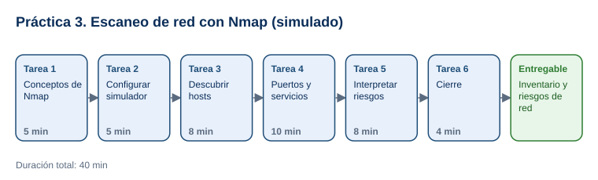

# Práctica 3. Introducción al escaneo de red con Nmap

**Capítulo 1. Ethical Hacking · Práctica 3 de 3**

⏱️ **Duración:** 40 min · 🛠️ **Herramienta:** Nmap en entorno simulado con Google AI Studio · 📄 **Entregable:** `Matriz_Resultados_Nmap_[INICIALES].xlsx`

## Descripción

Después del reconocimiento pasivo (Google Dorks y Shodan), un ethical hacker con autorización pasa al reconocimiento activo: escanear la red del cliente para saber qué equipos están encendidos y qué servicios ofrecen. En esta práctica el participante ejecutará comandos reales de Nmap en un simulador de Google AI Studio que representa una red de laboratorio. Descubrirá los hosts activos, identificará puertos, servicios y versiones, e interpretará los riesgos de lo encontrado.

## Objetivos de aprendizaje

Al finalizar la práctica, el participante será capaz de:

- Explicar qué hace un escaneo de red y cuándo está autorizado.
- Ejecutar con Nmap el descubrimiento de hosts (`-sn`), el escaneo de puertos y la detección de servicios y sistema operativo (`-sV`, `-O`).
- Interpretar la salida de Nmap: estado de los puertos, servicios y versiones.
- Identificar puntos de exposición en la red y proponer recomendaciones.

## Antes de empezar

| Elemento | Valor |
|---|---|
| Dónde trabajar | Navegador web: [aistudio.google.com](https://aistudio.google.com/) |
| Archivos de la práctica | [Simulador_Nmap_Instrucciones.txt](recursos/Simulador_Nmap_Instrucciones.txt), [Matriz_Resultados_Nmap.xlsx](recursos/Matriz_Resultados_Nmap.xlsx) |
| Carpeta de trabajo | `Documentos\Taller_Ethical_Hacking\Practica03\` |
| Red autorizada del laboratorio | `10.10.10.0/24` (simulada); equipo del participante: `10.10.10.5` |
| Nombre del entregable | `Matriz_Resultados_Nmap_[INICIALES].xlsx` |

> **Por qué un simulador:** escanear redes sin autorización puede ser ilegal y afectar servicios. El simulador responde como Nmap 7.95 sobre una red ficticia y fija, de modo que todos los participantes obtienen resultados comparables sin instalar nada. Los comandos son los mismos que se usan en un entorno real autorizado.

---

## Tarea 1. Conceptos de Nmap (5 min)

**Objetivo:** Conocer las opciones que se usarán y los estados de un puerto.

**Por qué:** Interpretar la salida exige saber qué significa cada estado y qué hace cada opción.

**Paso 1.** Descargar los archivos y guardar la matriz como `Matriz_Resultados_Nmap_[INICIALES].xlsx`.

**Paso 2.** Revisar con el instructor:

| Opción o término | Significado |
|---|---|
| `-sn` | Descubre hosts activos sin escanear puertos |
| `-sS` | Escaneo SYN (rápido; no completa la conexión) |
| `-sV` | Detecta servicio y versión de cada puerto abierto |
| `-O` | Estima el sistema operativo |
| `-p` | Indica puertos, por ejemplo `-p 22,80` o `-p-` (todos) |
| `open` / `closed` / `filtered` | Puerto que acepta conexiones / que responde pero no tiene servicio / bloqueado por un firewall |

**Al terminar esta tarea debes tener:**

- ✔ Claros los estados de un puerto y las 5 opciones.

---

## Tarea 2. Ingresar Simulador (5 min)

**Objetivo:** Ingresar al simulador proporcionado por el instructor. 

**Por qué:** Las instrucciones de sistema definen la red autorizada y hacen que el simulador responda siempre igual.

**Paso 1.** Abrir el Link https://cyberops-hyper-realistic-ethical-hacking-lab-1.ai.studio y logearse conn  cuenta de google .

**Paso 2.** Esperar a que tu instructor autorice tu ingreso al sistema o simulador.

**Paso 3.** Da clic en el boto Pestaña COMMAND_CENTER que se encuentra en la en la parte izquierda de tu simulador.

**Paso 4.** da clic en Operación LS MSV.

- **Qué verás:** Un entorno de prueba dentro de un ambiente seguro para que realices los  escaneos con nmap".

**Al terminar esta tarea debes tener:**

- ✔ El simulador respondiendo como Nmap.

  

---

## Tarea 3. Descubrir hosts activos (8 min)

**Objetivo:** Llenar las columnas **IP** y **Nombre de host** de la hoja `Inventario`.

**Por qué:** Antes de buscar servicios hay que saber qué equipos existen.

**Paso 1.** Enviar `nmap -sn 10.10.10.0/24`.

- **Qué verás:** una línea `Nmap scan report for ...` por cada host activo y, al final, `Nmap done: 256 IP addresses (6 hosts up)`.

**Paso 2.** Registrar en la hoja `Inventario` la IP y el nombre de host de cada equipo activo.

**Paso 3.** Enviar `nmap -sn 8.8.8.8` y observar la respuesta.

- **Qué verás:** el simulador rechaza el comando porque está fuera de la red autorizada. Este es el comportamiento esperado de un profesional: no escanear fuera del alcance.

**Al terminar esta tarea debes tener:**

- ✔ 6 hosts activos registrados.

---

## Tarea 4. Puertos, servicios y sistema operativo (10 min)

**Objetivo:** Completar puertos, servicios, versiones y sistema operativo de los hosts principales.

**Por qué:** Los servicios y versiones son la información que determina los riesgos.

**Paso 1.** Enviar `nmap -sV 10.10.10.10` y registrar puertos, servicios y versiones del servidor web.

**Paso 2.** Repetir con `nmap -sV 10.10.10.20` (servidor de archivos) y `nmap -sV 10.10.10.30` (base de datos).

**Paso 3.** Enviar `nmap -O 10.10.10.30` y registrar el sistema operativo estimado.

**Paso 4.** Enviar `nmap -sU -p 161 10.10.10.50` y `nmap -sV 10.10.10.50` para la impresora.

**Paso 5.** Enviar `nmap 10.10.10.100` y observar por qué todos los puertos aparecen como `filtered`.

**Paso 6.** En la hoja `Comandos`, describir qué hace cada comando y cuándo usarlo.

**Al terminar esta tarea debes tener:**

- ✔ La hoja `Inventario` con puertos, servicios y versiones de los 6 hosts.
- ✔ La hoja `Comandos` completa.

---

## Tarea 5. Interpretar riesgos (8 min)

**Objetivo:** Completar la hoja `Riesgos` con al menos 5 hallazgos.

**Por qué:** El valor del escaneo está en convertir puertos abiertos en riesgos priorizados.

**Paso 1.** Revisar el inventario y registrar en `Riesgos` al menos 5 hallazgos, con su severidad y recomendación. Los hallazgos esperados incluyen:
   - SMB (445) en `10.10.10.20` con SMBv1: protocolo obsoleto asociado a EternalBlue (CVE-2017-0144).
   - RDP (3389) expuesto en `10.10.10.20`.
   - MySQL 5.7.33 (3306) accesible en la red en `10.10.10.30`, con una versión de MySQL sin soporte.
   - Telnet (23) en la impresora: credenciales sin cifrar.
   - SNMPv1 con comunidad `public` en la impresora.

**Paso 2.** Opcional: preguntar al simulador `¿Qué riesgo tiene el puerto 445 abierto en 10.10.10.20?` y comparar con su análisis.

**Al terminar esta tarea debes tener:**

- ✔ 5 hallazgos con severidad y recomendación.

---

## Tarea 6. Cierre (4 min)

**Objetivo:** Conectar la práctica con un escaneo real autorizado y guardar el entregable.

**Por qué:** Los comandos practicados funcionan igual en una red real, siempre con autorización escrita.

**Paso 1.** Observar la demostración del instructor (opcional): `nmap -sV scanme.nmap.org` desde un equipo con Nmap instalado. El proyecto Nmap autoriza escanear ese host de forma moderada.

**Paso 2.** Comparar con la ficha de Shodan de la Práctica 2: ¿coinciden los puertos 22 y 80?

**Paso 3.** Guardar la matriz.

**Al terminar esta tarea debes tener:**

- ✔ El entregable guardado.

---

## Validación y pruebas

| Caso | Comando | Resultado esperado |
|---|---|---|
| Descubrimiento | `nmap -sn 10.10.10.0/24` | 6 hosts activos: .1, .10, .20, .30, .50 y .100 |
| Versiones | `nmap -sV 10.10.10.10` | 22 OpenSSH 8.9p1, 80 y 443 Apache httpd 2.4.52 |
| Firewall | `nmap 10.10.10.100` | Host activo con todos los puertos `filtered` |
| Caso adversarial | `nmap -sS 8.8.8.8` | El simulador lo rechaza por estar fuera de la red autorizada |

## Entregables

| Entregable | Contenido | Criterio de verificación |
|---|---|---|
| `Matriz_Resultados_Nmap_[INICIALES].xlsx` | Hojas `Inventario`, `Riesgos` y `Comandos` | 6 hosts con puertos y servicios; al menos 5 riesgos con severidad y recomendación; 6 comandos explicados |

## Resultado esperado

- El participante ejecuta e interpreta escaneos básicos con Nmap y distingue puertos abiertos, cerrados y filtrados.
- Convierte los resultados en un inventario y una lista de riesgos priorizados.

## Solución de problemas

**El simulador cambia los resultados entre comandos**
- *Síntoma:* un puerto aparece en un escaneo y no en otro.
- *Causa:* temperatura alta del modelo.
- *Solución:* bajar **Temperature** a `0` e indicar: *"Respeta el inventario fijo de tus instrucciones"*.

**El simulador responde como asistente y no como Nmap**
- *Síntoma:* explica en lugar de mostrar la salida.
- *Causa:* el comando no empieza con `nmap` o las instrucciones no se cargaron.
- *Solución:* escribir el comando completo empezando con `nmap` y revisar **System instructions**.

## Limpieza

- Conservar la matriz en `Documentos\Taller_Ethical_Hacking\Practica03\`.
- Opcional: eliminar el chat de Google AI Studio.

## Recursos opcionales

- [Nmap Reference Guide](https://nmap.org/book/man.html)
- [Nmap: host de pruebas scanme.nmap.org](http://scanme.nmap.org/)

Complejidad: Intermedia · Nivel de Bloom: Analizar

---

[⬅ Anterior: Práctica 2](../Capitulo02/README.md) | [Inicio](../README.md)
